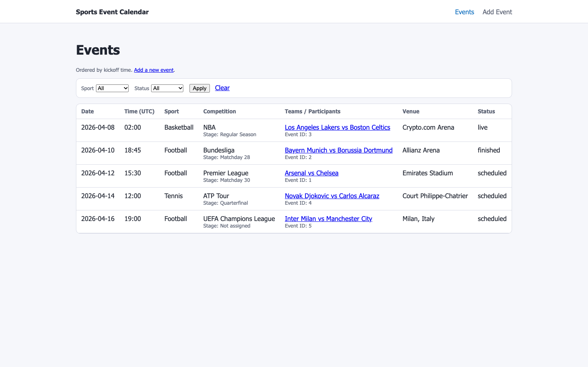

# Sports Event Calendar


A valid kickoff time can conflict with a match's status.

Sports Event Calendar stores fixtures in SQLite, lists them by kickoff time, and filters them by sport and status. You can add, edit, or delete events using shared competition, team, stage, and venue records. The server checks that dates, scores, and statuses agree before saving a form.

Backend coding-academy exercise, with its original reflection retained in docs. Built with AI assistance.

[Run locally](#run-locally) · [Docs](#docs)



The local app showing its built-in sample dataset.

## How it works

1. [models.py](models.py) defines the six related tables, foreign keys, indexes, and score/team checks.
2. [init_db.py](init_db.py) creates the SQLite schema; [seed_data.py](seed_data.py) loads local JSON or sample fixtures and reuses matching records.
3. [app.py](app.py) filters and sorts events, loading related records before rendering the [event list](templates/events_list.html) and [detail](templates/event_detail.html).
4. The same form validation in `app.py` handles creation and edits, including team selection, kickoff time, status, and paired scores.

## Project layout

| Path | What | Start here |
| --- | --- | --- |
| `app.py` | Routes, queries, and form validation | [Application factory](app.py) |
| `models.py` | Sports, competitions, stages, teams, venues, and events | [Models](models.py) |
| `init_db.py`, `seed_data.py` | Local database setup and fixture import | [Seed loader](seed_data.py) |
| `templates/` | List, detail, and create/edit pages | [Event form](templates/event_form.html) |
| `tests/` | Route, validation, database, and seed behavior | [Tests](tests/test_app.py) |
| `docs/` | Schema diagram and assignment reflection | [Database design](docs/ERD.md) |

## Run locally

Requires Python 3.12. Run these commands from a shell on macOS or Linux.

```bash
git clone https://github.com/yy31104/sportradar-coding-academy-be.git
```

```bash
cd sportradar-coding-academy-be
```

```bash
python3.12 -m venv .venv
```

```bash
.venv/bin/python -m pip install -r requirements.txt
```

```bash
.venv/bin/python init_db.py
```

```bash
.venv/bin/python seed_data.py
```

```bash
.venv/bin/python app.py
```

Open [127.0.0.1:5000/events](http://127.0.0.1:5000/events), filter the list, or choose Add Event. Data is stored in the ignored `instance/events.db` file. On Windows, use `.venv\Scripts\python.exe` for the commands after environment creation.

Tests take about a second after installation:

```bash
.venv/bin/python -m unittest -v tests.test_app
```

## Design notes

Competition, sport, team, stage, and venue records are shared across events. List and detail queries use `joinedload` so rendering related fields avoids a separate lookup for every row.

Creation and editing share the same server validation. Database checks also reject identical home/away teams and negative scores; status/time/score consistency is handled in the application.

## Limits

- This is a local demo without accounts or permissions; visitors can edit and delete events.
- Kickoff times are treated and displayed as UTC; the UI has no per-user timezone conversion.
- The built-in sample fixtures have fixed dates and statuses. Live schedules require a separate data source.

## Docs

- [Database design](docs/ERD.md)
- [Mermaid diagram](docs/erd.mmd)
- [Assignment reflection](docs/AI_Reflection.txt)
